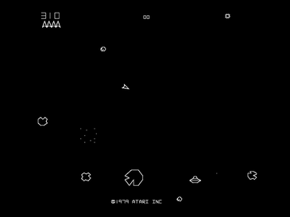
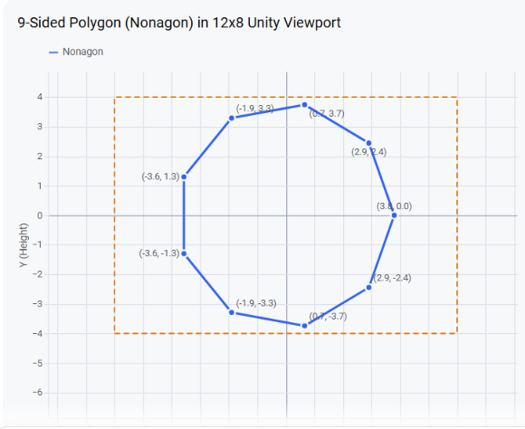
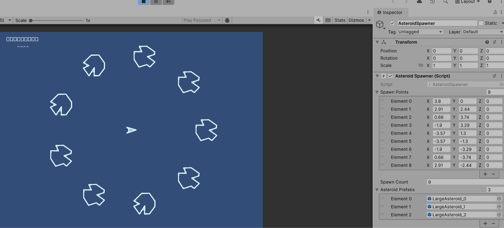
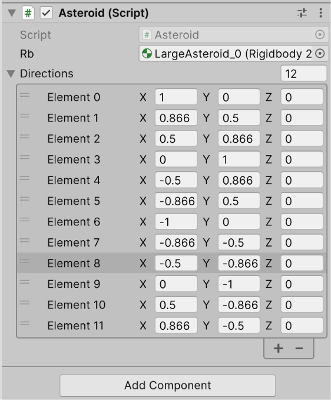
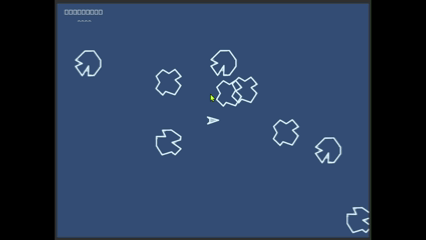
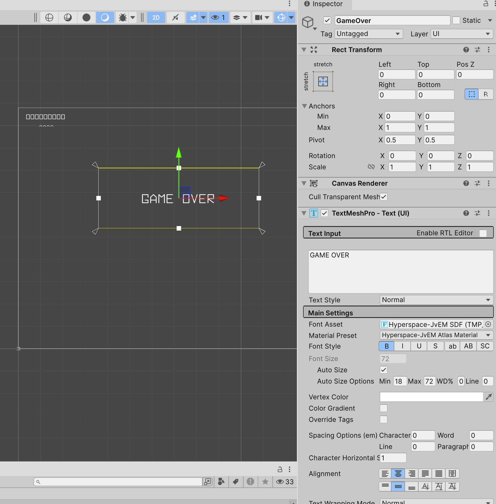

----

[TOC]

----

# Housekeeping

## Notes

## Unity, quick reminder of QWERTY tools:

| Command | Tool/Mode | Description |
| :--- | :--- | :--- |
| **Q** | Hand | For panning and navigating the Scene view. |
| **W** | Move | For translating (moving) objects along their X, Y, and Z axes. |
| **E** | Rotate | For rotating objects around their local or global axes. |
| **R** | Scale | For uniformly or non-uniformly scaling (stretching/resizing) objects. |
| **T** | Rect Transform | Primarily used for UI elements and 2D objects. |
| **Y** | Transform | A combination of the Move, Rotate, and Scale tools in a single gizmo. |

## Build Notes
- I am using 6000.6.7f1
- Universal Render 2D Pipeline is active
- In my notes, I  refer to panels as:

| &nbsp; Panel Name &nbsp; | &nbsp; Short Form &nbsp; | &nbsp; Description &nbsp; |
| :--- | :--- | :--- |
| &nbsp; Scene | &nbsp; **S** | &nbsp; Where you can drag objects and build 3D scene |
| &nbsp; Hierarchy | &nbsp; **H** | &nbsp;  See objects and their inheritance |
| &nbsp; Inspector | &nbsp; **I** | &nbsp; Detailed information on components for selected object &nbsp;|
| &nbsp; Project | &nbsp; **P** | &nbsp;  See resources relative to file directory |
| &nbsp; Game | &nbsp; **G** | &nbsp; Where the game is played |

# Setup Project

## Create Project
- Organization: whatever you like
- Project Name: Unity\_Asteroids
- no Cloud, no AI, no CLI, no Source Control
- Create Project
- Close annoying popup
- right click A, Welcome; delete it

## Set up git
- YMMV
<pre style="background-color: #505050; color: #ffffff; padding:15px; margin:5px">
PowerShell 7.6.9
PS C:\Users\steve> set-Location C:\Users\steve\unity_projects\Unity_Asteroids\
PS C:\Users\steve\unity_projects\Unity_Asteroids> copy '..\MissileCommand\.gitignore' .
PS C:\Users\steve\unity_projects\Unity_Asteroids> git init
Initialized empty Git repository in C:/Users/steve/unity_projects/Unity_Asteroids/.git/
PS C:\Users\steve\unity_projects\Unity_Asteroids> git add .
...
PS C:\Users\steve\unity_projects\Unity_Asteroids> git commit -m "Initial commit"
[master (root-commit) 2e79a0b] Initial commit
 51 files changed, 6383 insertions(+)
...
PS C:\Users\steve\unity_projects\Unity_Asteroids>
</pre>

# About the Game
- notes about game play
- from Wikipedia:
- 
## Player Ship
- you pilot a small triangular shaped ship
- it can turn left or right
- you can apply force to push the ship; ship moves but slows over time
- you can fire pixels from the nose of the ship
- you can trigger hyperscape jump to random location
## Asteroids
- asteroids come in large, medium and small
- they float, without slowing down
- when a asteroid explodes, the double and move in new directions
- (until small)
- the move at different speeds
- large is X 
- medium is 33.3 % faster
- small is 66.6 % faster
- points for destroying them are: 20, 50, 100 
## Saucers
- large saucer, is slow and random, fires "at" player. 200 
- small saucer, is faster and less random, and fires at player: 1000
## About Points
- at 10000, get an extra player
- at 10000, large saucers
- at 40000, small saucers
## About Waves
- wave 1: 4 large asteroids
- wave 2: 6 large asteroids
- wave 3: 8 large asteroids
- wave 4: 9 large asteroids
- 9 is the maximum
## Play
- yah player appears in center of screen, no force vector
- a few seconds later, wave begins 
- the asteroids appear, away form player, and starts to move
- player can move, can shoot
- once the asteroids are destroyed
- (4 -> 8 - > 16 = 28 hits )
- wait a fews seconds, increase wave count, and continue

## Thoughts?
- we need a GameManager singleton
- we need a MainCanvas, with a Panel in the upper left for score display
- we need Player class
- we need an Asteroid class
- we need a Large Saucer class
- we need a Small Saucer class
- we need fonts
- we need background music
- we need sounds: 
    - asteroid explosion
    - player fire
    - player explosion
    - saucer fire
    - saucer explosion
    - whatever else :-)
- we need sprites
    - large asteroid
    - medium asteroid
    - small asteroid
    - large saucer
    - small saucer
    - player
    - and some sort of explosion animations
- of course, this is not everything, and may have to change
- screen is 4:3
- need to think about ideal pixel-unity units

# Build It

## Font
- Download: https://www.fontspace.com/get/family/x3qqj
<pre style="background-color: #505050; color: #ffffff; padding:15px; margin:5px">
license: Freeware, commercial use requires donation
link: https://www.fontspace.com/hyperspace-font-f18038
</pre>
- extract the hyperspace-font.zip into a folder
- Make a Assets folder called Fonts
- Drag in Hyperspace-JvEM.ttf into it
- rclick A, FOnts, Hyperspace-JvEM; create, TextMeshPro, Font Asset, SDF
- triggers the damn TMP import (WHY IS THIS NOT BUILT IN)
- so lets do that
- then rclick A, FOnts, Hyperspace-JvEM; create, TextMeshPro, Font Asset, SDF
- git break

## Add Canvas and fields
- rclick H; create UI, Canvas; rename MainCanvas
    - UI Scale Mode: Scale with Screen Size
    - Reference Resolution: 1920 x 1080
- rclick H, MainCanvas; add UI, Panel; rename ScorePanel
    - Left: 0 Top: 0  PosX: 0
    - Right: 0  Bottom: 0
    - Anchors Min: 0    0.8
    -         Max: 0.25 1.0
    - Pivot: 0.5 0.5
    - (so the upper left corner) 
    - Color; set alpha to 0
- rclick H, MainCanvas, ScorePanel; add UI, Text; rename Score
    - Left: 0 Top: 0  PosX: 0
    - Right: 0  Bottom: 0
    - Anchors Min: 0.1  0.5
    -         Max: 0.6  0.9
    - Pivot: 0.5 0.5
    - Text: 123456789
    - Font: Hyperspace
    - AutoSize [x]  (around 43)
    - Alignment - center and center
- for now. lets add text of how many ships are left
- dupe Score; rename Ships
    - set top 75 (font should decrease)
    - Text: ^^^^
    - yah, futz about until your get it looking ok
    - I ended up top aligning Score, bottom aligning Ships
    - I'll probably keep futzing for a bit (like try them bold)
- git break

## Add GameManager 
- rclick H; create Emppty; rename GameManager
- Edit - Project Settings - Editor 
    - Root namespace: Asteroids
    - Close
- rclick A; create Folder; name Scripts
- rclick A, Scripts; create Mono; name GameManager
    - this will trigger a compile
- open GameManager
- do the 7,17d thing (remove the Start/Update)
- do the singleton thing
<pre style="background-color: #505050; color: #ffffff; padding:15px; margin:5px">
using UnityEngine;

namespace Asteroids
{
    public class GameManager : MonoBehaviour
    {
        private static GameManager instance;
        public static GameManager Instance { get => instance; private set => instance = value; }
        private void Awake()
        {
            if (Instance != null && Instance !=this) 
            { 
                Destroy(gameObject);
                return;
            }
            Instance = this;
            DontDestroyOnLoad(gameObject);
        }
    }
}
</pre>
- add a SF for Score text field, and logic
<pre style="background-color: #505050; color: #ffffff; padding:15px; margin:5px">
...
        [SerializeField] private TextMeshProUGUI Score;
        private int score = 0;
...
        private void Update()
        {
            Score.text = score.ToString("000000000");
        }
</pre>
- save, unity
- H, GameManager
    - add comp: GameManager
        - Score: drag Score from the canvas here
- nice, lets do the same with Ship count
- open GameManager
- add SFs and logic
<pre style="background-color: #505050; color: #ffffff; padding:15px; margin:5px">
        [SerializeField] private TextMeshProUGUI Ships;
        private int ships = 4;
        private string shipReference = "^^^^^^^^^^^^";
...
        private void Update()
        {
            Score.text = score.ToString("000000000");
            Ships.text = shipReference[^ships..];    //<--- here
        }
</pre>
- save, assign Ship to GameManager
- finally, add accessors in GameManager to change score and ships
<pre style="background-color: #505050; color: #ffffff; padding:15px; margin:5px">
        public void UpdateScore(int amount = 1)
        {
            score += amount;
        }
        public void UpdateShips(int amount = 1)
        {
            ships += amount;
        }
</pre>
- approx.; may change later
- git break

## Create Game Sprites
- A; creat folder; name Sprites
- find some decent images online (or make them yourself)
- mine is from [link](https://opengameart.org/content/asteroids-vector-style-sprites
)
    - credit to Joe Strout
- rename to asteroids-spritesheet
- drag onto Sprites folder
- unity will automatically try to cut your spritesheet
- you may need to open and edit it; I got lucky
- rclick H; create empty; name Player
- rclick H, Player; 2D, Sprites, Capsule
    - Sprite: asteroids-spritesheet_10
- observe that you can rotate this by changing H, Player, Z: 180
- create A, Prefabs
- drag H, Player into A, Prefabs
- rclick H; create empty; name LargeAsteroid0
- rclick H, LargeAsteroid0; 2D, Sprites, Capsule
    - Sprite: asteroids-spritesheet_0
- drag H, LargeAsteroid0 into A, Prefabs
- repeat this process. You can dupe; but unpack and make unique prefabs
- hmm. no small saucer? no problem, make a variant of large saucer and scale 0.5
- I also did the Bullets provided; not sure I will use them though
- Should look like:
- 
- couple notes:
    - we will need to add colliders
    - we should clean up the sprite sheet
    - we may need to scale
- git break

## Make a GameScene
- we have a prefab, Player
- lets make a new scene, called GameScene
- save, just in case
- in A, Scenes, dupe SampleScene; rename GameScene
- dclick GameScene
- remove:
    - Player 
    - PlayerBoosted 
    - LargeAsteroid_0 
    - LargeAsteroid_1 
    - LargeAsteroid_2 
    - MediumAsteroid_0 
    - MediumAsteroid_1 
    - MediumAsteroid_2 
    - SmallAsteroid_0 
    - SmallAsteroid_1 
    - SmallAsteroid_2 
    - LargeSaucer 
    - SmallSaucer 
    - Bullet_0 
    - Bullet_1
- File - Build Profiles; Scene List
    - drag GameScene in there
    - and move GameScene top of list
    - close
- save
- git break

## Player
- drop A, Prefabs, Player onto H 
- rclick A, Scripts; create Mono, name Player
- open Player script
- do the 7,17d thing 
- add SF for player
<pre style="background-color: #505050; color: #ffffff; padding:15px; margin:5px">
        [SerializeField] private GameObject player;
</pre>
- we need controls
<pre style="background-color: #505050; color: #ffffff; padding:15px; margin:5px">
- Rotate Left
- Rotate Right
- Forward Thrust
- Fire
- Hyperspace
</pre>
- lets rough in some controls for now
<pre style="background-color: #505050; color: #ffffff; padding:15px; margin:5px">
using UnityEngine.InputSystem;
...
        private void Update()
        {
            if (Keyboard.current.rightArrowKey.wasPressedThisFrame)
            {
                Debug.Log("Player::Update Rotate Right");
            }
            if (Keyboard.current.leftArrowKey.wasPressedThisFrame)
            {
                Debug.Log("Player::Update Rotate Left");
            }
            if (Keyboard.current.downArrowKey.wasPressedThisFrame)
            {
                Debug.Log("Player::Update Down Arrow Pressed");
            }
            if (Keyboard.current.upArrowKey.wasPressedThisFrame)
            {
                Debug.Log("Player::Update Thrust");
            }
            if (Keyboard.current.spaceKey.wasPressedThisFrame)
            {
                Debug.Log("Player::Update Hyperspace");
            }
        }
</pre>
- save
- H, Player
    - add comp: Player Script
    - drag Player onto it. 
- run some tests, keys are bing captured, excellent
- now, we want constant scans, and rotations on the Z (aka forward)
- so:
<pre style="background-color: #505050; color: #ffffff; padding:15px; margin:5px">
using UnityEngine;
using UnityEngine.InputSystem;

namespace Asteroids
{
    public class Player : MonoBehaviour
    {
        [SerializeField] private GameObject player;
        [SerializeField] private float rotationSpeed = 100f;

        private void Update()
        {
            if (Keyboard.current.rightArrowKey.isPressed)
            {
                Debug.Log("Player::Update Rotate Right");
                player.transform.Rotate(Vector3.forward, -rotationSpeed * Time.deltaTime);
            }
            if (Keyboard.current.leftArrowKey.isPressed)
            {
                Debug.Log("Player::Update Rotate Left");
                player.transform.Rotate(Vector3.forward, rotationSpeed * Time.deltaTime);
            }
            if (Keyboard.current.downArrowKey.isPressed)
            {
                Debug.Log("Player::Update Down Arrow Pressed");
            }
            if (Keyboard.current.upArrowKey.isPressed)
            {
                Debug.Log("Player::Update Thrust");
            }
            if (Keyboard.current.spaceKey.isPressed)
            {
                Debug.Log("Player::Update Hyperspace");
            }
        }
    }
}
</pre>
- save, unity, run test, it rotates
- hmm. Need to decide on a "Fire" button.
- the fire button should be wasPressedthisFrame, not a is pressed? hmm.
- save
- git break

## Player thrust
- two things I want to address.
    - apply a declining forward force on the player game object
    - and display a different sprite when thrusting
- we could use an animation for the sprite toggle
- or we could toggle the sprites
- dclick A, Prefabs, Player
- drag A, Sprites, asteroids-spritesheet_11 onto Player, rename Thrust
- disable it, for now
- open the player script
- add SFs for the states (thrust and sprite)
<pre style="background-color: #505050; color: #ffffff; padding:15px; margin:5px">
        [SerializeField] private GameObject thrust;
        [SerializeField] private GameObject sprite;
</pre>
- lets write a coroutine that display the thrust for a second.
<pre style="background-color: #505050; color: #ffffff; padding:15px; margin:5px">
        private IEnumerator Thrust()
        {
            sprite.SetActive(false);
            thrust.SetActive(true);
            yield return new WaitForSecondsRealtime(0.5f);
            sprite.SetActive(true);
            thrust.SetActive(false);
        }
</pre>
- update change
<pre style="background-color: #505050; color: #ffffff; padding:15px; margin:5px">
            if (Keyboard.current.upArrowKey.wasPressedThisFrame)
            {
                //Debug.Log("Player::Update Thrust");
                StartCoroutine(Thrust());
            }
</pre>
- save that, unity, open player prefab, assign sprite and thrust
- and now the thrusting ship shows up
- ok, we need to add a collision
- dclick A, Prefabs, Player
    - add comp: Circle Collider 2D
        - offset: 0 0
        - radius: 0.25
    - add RigidBody 2D
        - gravity scale: 0
        - linear dampening: 0.5
- we may need to tweak these later
- open Player script
<pre style="background-color: #505050; color: #ffffff; padding:15px; margin:5px">
        [SerializeField] private float thrusterPower = 10f;

        private Rigidbody2D rb;

        private void Awake()
        {
            rb = GetComponent<Rigidbody2D>();
        }
</pre>
- and modify in update
<pre style="background-color: #505050; color: #ffffff; padding:15px; margin:5px">
            if (Keyboard.current.upArrowKey.wasPressedThisFrame)
            {
                //Debug.Log("Player::Update Thrust");
                StartCoroutine(Thrust());
                rb.AddForce(transform.right * thrusterPower ); //<-- here
            }
</pre>
- save, test, looks good
- note: you need to tap the thruster, not hold it down
- may change this later
- git break

## Scrolling
- if you fly up through the top, you teleport to the bottom
- so, create collision areas as a border
- rclick H, create empty; name NorthTeleporter
- rclick H, NorthTeleporter; create 2d, sprite, square
    - position: 0 0 0
    - scale: 15 1 1 
- H, NorthTeleporter
    - add comp: Box Collider 2D
    - is trigger [x]
- drag into prefabs
- A, Prefabs, NorthTeleporter
    - Size X: 15
    - add comp: Teleporter (new script)
- open script Teleporter
- 7,17d
<pre style="background-color: #505050; color: #ffffff; padding:15px; margin:5px">
using UnityEngine;

namespace Asteroids
{
    public class Teleporter : MonoBehaviour
    {
        [SerializeField] private float newx = -99f;
        [SerializeField] private float newy = -99f;

        private void OnTriggerEnter2D(Collider2D other)
        {
            Vector3 newPosition = other.transform.position;
            newPosition.x = newx == -99f ? newPosition.x : newx;
            newPosition.y = newy == -99f ? newPosition.y : newy;
            other.transform.position = newPosition; 
        }
    }

}
</pre>
- notes: -99 is way bigger than the screen; so if its that just skip it
- otherwise, just set it
- save, unity
- H, NorthTeleporter
    - Position: 0 5.5 0
    - NewX: -99 
    - NewY: -4.5
- dupe H, NorthTeleporter; rename SouthTeleporter
- H, SouthTeleporter
    - Position: 0 -5.5 0
    - NewX: -99 
    - NewY: 4.5
- dupe H, NorthTeleporter; rename EastTeleporter
- H, EastTeleporter
    - Position: -7.5 0 0
    - NewX: 6.5 
    - NewY: -99
- dupe H, EastTeleporter; rename WestTeleporter
- H, WestTeleporter
    - Position: 7.5 0 0
    - NewX: -6.5 
    - NewY: -99
- save, test 
- bug: the thruster is making me crazy. Need to have is pressed? check.
- git check

## Bullet Break

### add cannon
- dclick A, Prefabs, Player
- rclick H, Player; create empty; rename Cannon
    - Position: 0.3 0.01 0.0

### add bullet behaviour
- dclick Prefabs, Bullet_1
    - add comp: circle collider 2d
    - radius: 0.05
    - add comp: rigidbody 2d
    - gravity scale : 0
    - add comp: Bullet (New Script)
- open Bullet script
<pre style="background-color: #505050; color: #ffffff; padding:15px; margin:5px">
using UnityEngine;

namespace Asteroids
{
    public class Bullet : MonoBehaviour
    {
        [SerializeField] private float lifetime = 1.0f;
        [SerializeField] private Rigidbody2D rb;

        private void Awake()
        {
            rb = GetComponent<Rigidbody2D>();
        }

        void Start()
        {
            Destroy(gameObject, lifetime);
            rb.AddForce(gameObject.transform.right * 500f);
        }

    }
}
</pre>

### fire a bullet
- open Player script
- SFs
<pre style="background-color: #505050; color: #ffffff; padding:15px; margin:5px">
       [SerializeField] private GameObject cannon;
       [SerializeField] private GameObject bulletPrefab;
</pre>
- change space to fire
<pre style="background-color: #505050; color: #ffffff; padding:15px; margin:5px">
            if (Keyboard.current.spaceKey.wasPressedThisFrame) //isPressed)
            {
                Instantiate(bulletPrefab, cannon.transform.position, cannon.transform.rotation, null);
            }
</pre>
- save, open Player prefab
- assign Cannon and Bullet Prefab in script

## Spawn Asteroids
- need some "random" spawn points
- I will use a 9 sided polygon
- (I realize the original used actual random numbers)
<pre style="background-color: #505050; color: #ffffff; padding:15px; margin:5px">
• Vertex 1: (3.80, 0.00)
• Vertex 2: (2.91, 2.44)
• Vertex 3: (0.66, 3.74)
• Vertex 4: (-1.90, 3.29)
• Vertex 5: (-3.57, 1.30)
• Vertex 6: (-3.57, -1.30)
• Vertex 7: (-1.90, -3.29)
• Vertex 8: (0.66, -3.74)
• Vertex 9: (2.91, -2.44)
</pre>
- 
- then we can pick a random point to drop a large asteroid
- rclick H; create Empty; name AsteroidSpawner
- H, AsteroidSpawner
    - add comp: AsteroidSpawner (New Script)
- open AsteroidSpawner
- 7,17d
<pre style="background-color: #505050; color: #ffffff; padding:15px; margin:5px">
using System.Collections; 
using System.Collections.Generic;
using UnityEngine;
using System.Linq;

namespace Asteroids
{
    public class AsteroidSpawner : MonoBehaviour
    {
        [SerializeField] private List<Vector3> spawnPoints;
        [SerializeField] private int spawnCount = 1;

        [SerializeField] private List<GameObject> asteroidPrefabs;

        private void Start()
        {
            GenerateAsteroids(spawnCount);
        }
        public void GenerateAsteroids(int amount)
        {
            List<int> randomSpawnIndexes = RandomizeSpawnLocations();
            for (int i = 0; i < amount; i++)
            {
                Vector3 randomPoint = spawnPoints[randomSpawnIndexes[i]];
                int randomAsteroid = Random.Range(0, asteroidPrefabs.Count);
                Instantiate(asteroidPrefabs[randomAsteroid], randomPoint, transform.rotation);
            }
        }

        private List<int> RandomizeSpawnLocations()
        {
            List<int> temp = new List<int>() { 0, 1, 2, 3, 4, 5, 6, 7, 8 };
            temp = temp.OrderBy(x => Random.value).ToList();
            return temp;
        }
    }
}
</pre>
- save unity assign fields
- 
- we need to apply a direction 

## Game Layers
- to manage collisions, we will need layers
- add layers
<pre style="background-color: #505050; color: #ffffff; padding:15px; margin:5px">
Player
Enemy
</pre>
- we may add more later
- add a class to manage layers
- rclick A,Scripts; create, scripting, empty C# script; name Layers
- open Layers
<pre style="background-color: #505050; color: #ffffff; padding:15px; margin:5px">
using UnityEngine;

namespace Asteroids
{
    public static class Layers
    {
        // Built in layers
        public const int Default = 0;
        public const int TransparentFX = 1;
        public const int IgnoreRaycast = 2;
        public const int Water = 4;
        public const int UI = 5;

        // Custom Layers
        public static readonly int Player = LayerMask.NameToLayer("Player");
        public static readonly int Enemy = LayerMask.NameToLayer("Enemy");
    }
}
</pre>
- unity
- Edit-Project Settings- Physics2d - Layer Collision Matrix
    - uncheck: Enemy - Enemy
    - uncheck: Player - Player
- git break

## Asteroid: Collide with bullets
- dclick A, Prefabs, LargeAsteroid_0
- H, LargeAsteroid_0
    - add comp: Circular Collider 2D
    - Radius: .35
    - add comp: RigidBody 2D
    - Gravity Scale: 0
    - Layer: Enemy  (yes to children)
- dclick A, Prefabs, LargeAsteroid_1
- H, LargeAsteroid_1
    - add comp: Circular Collider 2D
    - Radius: .35
    - add comp: RigidBody 2D
    - Gravity Scale: 0
    - Layer: Enemy  (yes to children)
- dclick A, Prefabs, LargeAsteroid_2
- H, LargeAsteroid_2
    - add comp: Circular Collider 2D
    - Radius: .35
    - add comp: RigidBody 2D
    - Gravity Scale: 0
    - Layer: Enemy  (yes to children)

### bug fix: player should not spin out of control
- noticed this while testing
- open Player
- at the very bottom of Update, add:
<pre style="background-color: #505050; color: #ffffff; padding:15px; margin:5px">
            // bug fix: remove angular (spin) from the player
            rb.angularVelocity = 0f;
</pre>

## Modify the Player Bullets
- player bullets shouldn't push
- dclick A, Prefabs, Bullet_1
    - Is Trigger [x]
- that removes the push.
- next, open Bullet script
<pre style="background-color: #505050; color: #ffffff; padding:15px; margin:5px">
        private void OnTriggerEnter2D(Collider2D other)
        {
            // Check if the hit object belongs to the "Enemy" layer
            if (other.gameObject.layer == Layers.Enemy)
            {
                Debug.Log("Bullet::OnTriggerEnter2D Hit enemy; destroy it for now.");
                Destroy(other.gameObject);
            }
            // if bullet collides with anything; remove it
            Debug.Log("Bullet::OnTriggerEnter2D collided and removed bullet.");
            Destroy(gameObject);
        }
</pre>
- note: the bullet will now be destroyed if it hits the teleporter boundaries
- which is desired. (should confirm this)
- note: we will want to spawn smaller asteroids
- also note: we will need something similar for player-asteroid collisions
- asteroids don't push players, they explode them :-)

## Make Asteroids Destroy Players
- similar to the bullet, we will need an Asteroid script
- dclick A, Prefabs, LargeAsteroid_0
- H, LargeAsteroid_0
    - add comp: Asteroid (New Script)
    - Is Trigger [x]
- open Asteroid script
<pre style="background-color: #505050; color: #ffffff; padding:15px; margin:5px">
using UnityEngine;

namespace Asteroids
{
    public class Asteroid : MonoBehaviour
    {
        [SerializeField] private Rigidbody2D rb;

        private void Awake()
        {
            rb = GetComponent<Rigidbody2D>();
        }

        void Start()
        {
            rb.AddForce(gameObject.transform.right * 100f);
        }
        private void OnTriggerEnter2D(Collider2D other)
        {
            if (other.gameObject.layer == Layers.Player)
            {
                Debug.Log("Asteroid::OnTriggerEnter2D Hit player; destroy it for now.");
                Destroy(other.gameObject);
            }
        }
    }
}
</pre>
- save, unity
- A, Prefabs, Player
    - Layer: Player (yes children too)
- dclick A, Prefabs, LargeAsteroid_1
- H, LargeAsteroid_1
    - add comp: Asteroid
    - set RigidBody
    - Is Trigger [x]
- dclick A, Prefabs, LargeAsteroid_2
- H, LargeAsteroid_2
    - add comp: Asteroid
    - set RigidBody
    - Is Trigger [x]
- test, all the asteroids move now, at 100f (whatever that is)
- if they hit the player, the player is destroyed.

## Create Random Vectors to move asteroids
- lets create a list of vectors 
<pre style="background-color: #505050; color: #ffffff; padding:15px; margin:5px">
    new Vector3(1.0f    , 0.0f    , 0f),  //   0° (Right)
    new Vector3(0.866f  , 0.5f    , 0f),  //  30°
    new Vector3(0.5f    , 0.866f  , 0f),  //  60°
    new Vector3(0.0f    , 1.0f    , 0f),  //  90° (Up)
    new Vector3(-0.5f   , 0.866f  , 0f),  // 120°
    new Vector3(-0.866f , 0.5f    , 0f),  // 150°
    new Vector3(-1.0f   , 0.0f    , 0f),  // 180° (Left)
    new Vector3(-0.866f , -0.5f   , 0f),  // 210°
    new Vector3(-0.5f   , -0.866f , 0f),  // 240°
    new Vector3(0.0f    , -1.0f   , 0f),  // 270° (Down)
    new Vector3(0.5f    , -0.866f , 0f),  // 300°
    new Vector3(0.866f  , -0.5f   , 0f)   // 330°
</pre>
- in the asteroids script, add those vectors in
- 
- 

## Fix Bullets
- bullets do need to wrap
- add a layer , Teleporter
- assign Teleporter layer to North, South, East, West Teleporter
- open Layers
<pre style="background-color: #505050; color: #ffffff; padding:15px; margin:5px">
        public static readonly int Teleporter = LayerMask.NameToLayer("Teleporter");
</pre>
- open Bullet script
<pre style="background-color: #505050; color: #ffffff; padding:15px; margin:5px">
        private void OnTriggerEnter2D(Collider2D other)
        {
            if (other.gameObject.layer == Layers.Teleporter) return; // ignore.
...

</pre>
- next, can only have 4 bullets active 
- add a counter to the GameManager script
<pre style="background-color: #505050; color: #ffffff; padding:15px; margin:5px">
 private int activePlayerBullets = 0;
...
        public void AddPlayerBullet()
        {
            activePlayerBullets++;
        }
        public void SubPlayerBullet()
        {
            activePlayerBullets--;
        }
        public bool CanPlayerFire()
        {
            if (activePlayerBullets <4)
            {
                return true;
            }
            return false;
        }
</pre>
- note: this can be greatly simplified; add to bug list
- modify player script
<pre style="background-color: #505050; color: #ffffff; padding:15px; margin:5px">
            if (Keyboard.current.spaceKey.wasPressedThisFrame) //isPressed)
            {
                if (GameManager.Instance.CanPlayerFire())
                {
                    Instantiate(bulletPrefab, cannon.transform.position, cannon.transform.rotation, null);
                    GameManager.Instance.AddPlayerBullet();
                }
            }
</pre>
- next, add logic to the bullet to remove the bullet
<pre style="background-color: #505050; color: #ffffff; padding:15px; margin:5px">
        private void OnDestroy()
        {
            GameManager.Instance.SubPlayerBullet();
        }
</pre>
- save, test
- git break

## Score 
- When asteroid goes boom
- UpdateScore
- so in Asteroid
<pre style="background-color: #505050; color: #ffffff; padding:15px; margin:5px">
        private void OnDestroy()
        {
            GameManager.Instance.UpdateScore(asteroidValue);
        }
</pre>

<pre style="background-color: #505050; color: #ffffff; padding:15px; margin:5px">
    public enum AstroidSize
    {
        Large, Small, Medium
    }
</pre>
- modify
<pre style="background-color: #505050; color: #ffffff; padding:15px; margin:5px">
        public void SpawnAsteroid(AsteroidSize size=AsteroidSize.Large)
        {
            asteroidValue = size switch
            {
                AsteroidSize.Large => 20,
                AsteroidSize.Medium => 50,
                AsteroidSize.Small => 100,
                _    => asteroidValue
            };

            // maybe scale as well?
            List<int> dirs = RandomizeDirections();
            rb.AddForce(directions[dirs[0]] * 100f);
        }
</pre>
- now we can shoot steroids and the points increase
- lets increase speed
<pre style="background-color: #505050; color: #ffffff; padding:15px; margin:5px">
[SerializeField] private float speed = 100f;
</pre>
- and one more update to SpawnAsteroid
<pre style="background-color: #505050; color: #ffffff; padding:15px; margin:5px">
        public void SpawnAsteroid(AsteroidSize size=AsteroidSize.Small)
        {
            asteroidValue = size switch
            {
                AsteroidSize.Large => 20,
                AsteroidSize.Medium => 50,
                AsteroidSize.Small => 100,
                _    => asteroidValue
            };

            float tempScale = 1.0f;

            if (size == AsteroidSize.Small)
            {
                transform.localScale *= .33f;
                tempScale = 1.66f; 
            }
            if (size == AsteroidSize.Medium)
            {
                transform.localScale *= .66f;
                tempScale = 1.33f; 
            }
            // maybe scale as well?
            List<int> dirs = RandomizeDirections();
            rb.AddForce(directions[dirs[0]] * speed * tempScale);
        }
</pre>

## Asteriod rebirth
- lets have the GameManager do this
- open GameManager
- add SF for AsteroidSPawner
<pre style="background-color: #505050; color: #ffffff; padding:15px; margin:5px">
        [SerializeField] private AsteroidSpawner spawner;
        private int activeLargeAsteroids = 0;
        private int activeMediumAsteroids = 0;
        private int activeSmallAsteroids = 0;
        private int currentWave = 1;
</pre>
- add a method for spawning a wave
<pre style="background-color: #505050; color: #ffffff; padding:15px; margin:5px">
        public void SpawnWave()
        {
            int count = currentWave switch
            {
                1 => 4,
                2 => 6,
                3 => 8,
                _ => 9
            };
            spawner.GenerateAsteroids(count, AsteroidSize.Large);
        }
</pre>

- add a method for spawning a child asteroid pair
<pre style="background-color: #505050; color: #ffffff; padding:15px; margin:5px">
</pre>
- open AsteroidSpawner
    - add AsteroidSize size = AsteroidSize.Large to the signature
    - remove the GenerateAsteroids from the Start
- open Asteroid
<pre style="background-color: #505050; color: #ffffff; padding:15px; margin:5px">
        private void OnDestroy()
        {
            if (!gameObject.scene.isLoaded) return;

            if (GameManager.Instance != null) 
                GameManager.Instance.AsteroidDestroyed(size);
        }
</pre>
- probably shouldn't spawn stuff from an OnDestroy.
- mark it as a bug?
- also in Asteroid, found a bug
- need to assign Asteroid size
<pre style="background-color: #505050; color: #ffffff; padding:15px; margin:5px">
        public void SpawnAsteroid(AsteroidSize size)
        {
            this.size = size;
</pre>
- the default is Large, so that would give you infinite asteroids
- also, you can remove the asteroidValue code, that logic is in GameManager
- the spawn location of the exploded asteroid is going to random spawn point
- I think thats wrong. Need to check though
- remove the Start logic from Asteroid
- changes to GameManager
<pre style="background-color: #505050; color: #ffffff; padding:15px; margin:5px">
        [SerializeField] private AsteroidSpawner spawner;
        private int activeLargeAsteroids = 0;
        private int activeMediumAsteroids = 0;
        private int activeSmallAsteroids = 0;
        private int currentWave = 1;

        public void SpawnWave()
        {
            int count = currentWave switch
            {
                1 => 1, // 4
                2 => 6,
                3 => 8,
                _ => 9
            };
            spawner.GenerateAsteroids(count, AsteroidSize.Large);
            activeLargeAsteroids = count;
        }

        public void AsteroidDestroyed(AsteroidSize size)
        {
            if (spawner == null) return;

            int asteroidValue = 0;

            if (size == AsteroidSize.Large)
            {
                Debug.Log("GameManager:: AsteroidDestroyed and it was Large");
                asteroidValue = 20;
                activeLargeAsteroids--;
                spawner.GenerateAsteroids(2, AsteroidSize.Medium);
                activeMediumAsteroids += 2;
            } else if (size == AsteroidSize.Medium)
            {
                Debug.Log("GameManager:: AsteroidDestroyed and it was Medium");
                asteroidValue = 50;
                activeMediumAsteroids--;
                spawner.GenerateAsteroids(2, AsteroidSize.Small);
                activeSmallAsteroids += 2;
            } else
            {
                Debug.Log("GameManager:: AsteroidDestroyed and it was Small");
                asteroidValue = 100;
                activeSmallAsteroids--;
            }

            if (activeLargeAsteroids+ activeMediumAsteroids+activeSmallAsteroids == 0)
            {
                currentWave++;
                SpawnWave();
            }
            UpdateScore(asteroidValue);

        }
</pre>
- so need to think about direction and location of medium and small asteroids
- so need to think about when player explodes
- for now git break; "implement waves logic"

## Fix the do stuff from Destroy Issue
- apparently its bad practice to create stuff when you destroy stuff
- so, we push the responsibility up to the game manager
- we will need the asteroid size, so in Asteroid script add accessor
<pre style="background-color: #505050; color: #ffffff; padding:15px; margin:5px">
+        public AsteroidSize GetSize()
+        {
+            return size;
+        }
</pre>
- call GameManager when destroying player
<pre style="background-color: #505050; color: #ffffff; padding:15px; margin:5px">
             if (other.gameObject.layer == Layers.Player)
             {
                 Debug.Log("Asteroid::OnTriggerEnter2D Hit player; destroy it for now.");
-                Destroy(other.gameObject);
+                GameManager.Instance.PlayerDestroyed(other.gameObject);
+                //Destroy(other.gameObject);
             }
</pre>
- and remove the OnDestroy logic
<pre style="background-color: #505050; color: #ffffff; padding:15px; margin:5px">
-        private void OnDestroy()
-        {
-            if (!gameObject.scene.isLoaded) return;
-
-            if (GameManager.Instance != null)
-                GameManager.Instance.AsteroidDestroyed(size);
-        }
</pre>
- open Bullet
<pre style="background-color: #505050; color: #ffffff; padding:15px; margin:5px">
             if (other.gameObject.layer == Layers.Enemy)
             {
                 Debug.Log("Bullet::OnTriggerEnter2D Hit enemy; destroy it for now.");
-                Destroy(other.gameObject);
+                GameManager.Instance.AsteroidDestroyed(other.gameObject);
+                //Destroy(other.gameObject);
             }
</pre>
- and tweak GameManager
<pre style="background-color: #505050; color: #ffffff; padding:15px; margin:5px">
-        public void AsteroidDestroyed(AsteroidSize size)
+        public void AsteroidDestroyed(GameObject asteroid) //, AsteroidSize size)
         {
+            Asteroid a = asteroid.GetComponent<Asteroid>();
+            if (a == null) return;
+            AsteroidSize size = a.GetSize();
+
             if (spawner == null) return;

             int asteroidValue = 0;
@@ -113,6 +117,13 @@ namespace Asteroids
                 SpawnWave();
             }
             UpdateScore(asteroidValue);
+            Destroy(asteroid);
+
+
+        }
+        public void PlayerDestroyed(GameObject p)
+        {
+            Destroy(p);

         }
</pre>
- later we will need to expand PlayerDestroyed and add logic for Saucers
- git break "remove destroy/spawn intertwined logic"

## Player Resurrection
- I think we want to: 
    - deactivate the player, 
    - lower the player count, 
    - position at origin
    - wait 5 seconds (check for safe spot?)
    - put ship back
<pre style="background-color: #505050; color: #ffffff; padding:15px; margin:5px">
        public void PlayerDestroyed(GameObject p)
        {
            ships--;
            if (ships == 0)
            {
                // end game, change scene
            }
            else
            {
                Player player = p.GetComponent<Player>();
                if (player == null) return;
                p.SetActive(false); // make player go away
                StartCoroutine(ReincarnatePlayer(p));
            }
        }
        private IEnumerator ReincarnatePlayer(GameObject p)
        {
            // we should check if it is safe
            yield return new WaitForSecondsRealtime(2.5f);
            p.SetActive(true); // bring player back
        }
</pre>
- git break

## Multiple Games
- add a UIManager script to MainCanvas
- note: a lot of the logic can be cut paste from GameManager
<pre style="background-color: #505050; color: #ffffff; padding:15px; margin:5px">
using TMPro;
using UnityEngine;

namespace Asteroids
{
    public class UIManager : MonoBehaviour
    {
        [SerializeField] private TextMeshProUGUI Score;
        [SerializeField] private TextMeshProUGUI Ships;

        public void UpdateShips(int ships)
        {
            string shipReference = "^^^^^^^^^^^^";
            if (ships > -1)
            {
                Ships.text = shipReference[^ships..];
            }
        }

        public void UpdateScore(int score)
        {
            Score.text = score.ToString("000000000");
        }
    }
}
</pre>
- pop over to GameManager
<pre style="background-color: #505050; color: #ffffff; padding:15px; margin:5px">
        private UIManager ui;
</pre>
- remove the two references to UI elements
- modify Update
<pre style="background-color: #505050; color: #ffffff; padding:15px; margin:5px">
        private void Update()
        {
            ui.UpdateShips(ships);
            ui.UpdateScore(score);
        }
</pre>
- add logic to handle the scene "reload"
<pre style="background-color: #505050; color: #ffffff; padding:15px; margin:5px">

        private void OnEnable()
        {
            SceneManager.sceneLoaded += OnSceneLoaded;
        }

        private void OnDisable()
        {
            SceneManager.sceneLoaded -= OnSceneLoaded;
        }

        private void OnSceneLoaded(Scene scene, LoadSceneMode mode)
        {
            spawner = FindAnyObjectByType<AsteroidSpawner>();
            ui = FindAnyObjectByType<UIManager>();
            ResetGame();
            SpawnWave();
        }
        private void ResetGame()
        {
            score = 0;
            currentWave = 1;
            ships = 4;
        }
</pre>
- the issue was, in a nutshell, that when the scene loaded
- any SF would be reset
- I could propagate the singleton patterns
- or we can go looking for the new ones (which we did)
- save, unity
- H, MainCanvas, ScorePanel
   - drag Score and Ships into the UI Manager Script
- git break

## High Score
- not strictly required by game, but easy enough
- so long as we don't preserve between runs
- anyway, dupe ScorePanel; rename HighScorePanel
    - 0 0 0
    - 0 0
    - 0.75 0.80
    - 1    1
    - 0.5  0.5
    - remove Ships
    - rename Score to HighScore
- open GameManager
<pre style="background-color: #505050; color: #ffffff; padding:15px; margin:5px">
        private int highScore = 0;
</pre>
- add logic
<pre style="background-color: #505050; color: #ffffff; padding:15px; margin:5px">
        private void ResetGame()
        {
            if (score > highScore)
            {
                highScore = score;
                ui.UpdateHighScore(highScore);
            }
            score = 0;
            currentWave = 1;
            ships = 4;
        }
</pre>
- I suppose you might want that to dynamically update? hmm.
- that's a nice to have, but wouldn't be too hard to do 
- just do the check in the Update
- anyway, open UIManager script
- add SF
<pre style="background-color: #505050; color: #ffffff; padding:15px; margin:5px">
        [SerializeField] private TextMeshProUGUI HighScore;
</pre>
- and an updater
<pre style="background-color: #505050; color: #ffffff; padding:15px; margin:5px">
        public void UpdateHighScore(int score)
        {
            HighScore.text = score.ToString("000000000");
        }
</pre>
- save unity
- Main Canvas, assign HighScore to High Score in the script

### Bug: we need to reset the asteroid count
- or the game wont realize they are clear
- in GameManager, just update ResetGame
<pre style="background-color: #505050; color: #ffffff; padding:15px; margin:5px">
        private void ResetGame()
        {
            if (score > highScore)
            {
                highScore = score;
                ui.UpdateHighScore(highScore);
            }
            score = 0;
            currentWave = 1;
            ships = 4;
            activePlayerBullets = 0;
            activeLargeAsteroids = 0;
            activeMediumAsteroids = 0;
            activeSmallAsteroids = 0;
        }
</pre>
- save, unity, test
- hmm. I ended up moving the logic for highscore into Update
<pre style="background-color: #505050; color: #ffffff; padding:15px; margin:5px">
        private void Update()
        {
            ui.UpdateShips(ships);
            ui.UpdateScore(score);
            if (score > highScore)
            {
                highScore = score;
            }
            ui.UpdateHighScore(highScore);
        }
</pre>
- that way we can watch ourselves get the new highscore :-)
- git break

## Game Over Text
- dclick H, MainCanvas  (to being it into focus)
- rclick H, MainCanvas; create Panel, name: GameOverPanel
- 
- set to inactive by default
- open UIManager script
- add SF
<pre style="background-color: #505050; color: #ffffff; padding:15px; margin:5px">
        [SerializeField] private GameObject gameOver;
</pre>
- add toggle code
<pre style="background-color: #505050; color: #ffffff; padding:15px; margin:5px">
        public void ToggleGameOver()
        {
            gameOver.SetActive(!gameOver.activeSelf);
        }
</pre>
- save, unity
- H, MainCanvas
    - assign GameOver to GameOverPanel
- open script GameManager

## Saucer
- timer in game manager, based on logic (see above), launch saucer
- pick a spot
- pick a saucer (biased on logic (see above))
- zip across screen
- fire twice (again depends on type, large is random, small is accurate)
- update system to allow player to shoot saucer
- similar to asteroids, we can scale LargeSaucer
- create a script. name it Saucer
- open it
- do the 7,17d thing
- rough out a class GameManager can use
<pre style="background-color: #505050; color: #ffffff; padding:15px; margin:5px">
using System.Collections.Generic;
using UnityEngine;

namespace Asteroids
{
    public class Saucer : MonoBehaviour
    {
        [SerializeField] private GameObject saucerPrefab;
        private SaucerSize size; 
        public void SpawnSaucer(SaucerSize size, Vector3 location)
        {
            this.size = size;
            Saucer s = Instantiate<Saucer>(saucerPrefab, location, Quaternion.identity);
            switch (size)
            {
                case SaucerSize.Small:
                    s.transform.localScale = new Vector3(0.5f, 0.5f, 0.5f);
                    break;
                case SaucerSize.Large:
                    s.transform.localScale = Vector3.one;
                    break;
                default:
                    s.transform.localScale = Vector3.one; // Default size
                    break;
            }
        }
        public SaucerSize GetSize()
        {
            return size;
        }           
    }

    public enum SaucerSize
    {
        Large, Small
    }
}
</pre>
- GameManager
<pre style="background-color: #505050; color: #ffffff; padding:15px; margin:5px">
        private Saucer saucer;
...
        private void OnSceneLoaded(Scene scene, LoadSceneMode mode)
        {
            spawner = FindAnyObjectByType<AsteroidSpawner>();
            ui = FindAnyObjectByType<UIManager>();
            saucer = FindAnyObjectByType<Saucer>(); // <-- here
            ResetGame();
            SpawnWave();
            SpawnSaucers();  // needs to be a coroutine later
        }
...
        private void SpawnSaucers()
        {
            saucer.SpawnSaucer(SaucerSize.Large, new Vector3(5f, 5f, 0f));
        }
</pre>
- that should spawn a single saucer, good enough for a test
- save, unity
- rclick H; create empty; name Saucer; assign script Saucer to it
    - drag it off scene
- note: we only ever have one saucer, so we don't need a spawner
- but we do need something the GameManager can grab
- git break
- next, choose some possible spawn locations
- moving left to right
<pre style="background-color: #505050; color: #ffffff; padding:15px; margin:5px">
 -6.5 4.5
 -6.5 3.5
 -6.5 2.5
 -6.5 1.5
 -6.5 0.5
 -6.5 -0.5
 -6.5 -1.5
 -6.5 -2.5
 -6.5 -3.5
 -6.5 -4.5
</pre>
- and right to left
<pre style="background-color: #505050; color: #ffffff; padding:15px; margin:5px">
 6.5 4.5
 6.5 3.5
 6.5 2.5
 6.5 1.5
 6.5 0.5
 6.5 -0.5
 6.5 -1.5
 6.5 -2.5
 6.5 -3.5
 6.5 -4.5
</pre>
- also need to select start location
<pre style="background-color: #505050; color: #ffffff; padding:15px; margin:5px">
        private Vector3 GetRandomStartLocation()
        {
            return rightDirections[3];
        }
</pre>
- and also need to launch
<pre style="background-color: #505050; color: #ffffff; padding:15px; margin:5px">
        private void LaunchSaucer(Rigidbody2D rb)
        {
            rb.linearVelocity = Vector2.right * speed; ;
        }
</pre>
- add logic to destroy player on impact
<pre style="background-color: #505050; color: #ffffff; padding:15px; margin:5px">
        private void OnTriggerEnter2D(Collider2D other)
        {
            if (other.gameObject.layer == Layers.Player)
            {
                 GameManager.Instance.PlayerDestroyed(other.gameObject);
            }
        }
</pre>

- unity
- LargeSaucer prefab will need a circular collider 2d and a rigidbody 2D
     - set the gravity to 0, and radius to 0.25
     - Layer should be, Enemy (for now)
     - is trigger [x]

- Lets go ahead and create a Saucer layer
- and add LargeSaucer to it
- and to the Layers.cs script
<pre style="background-color: #505050; color: #ffffff; padding:15px; margin:5px">
        public static readonly int Saucer = LayerMask.NameToLayer("Saucer");
</pre>

#### saucer needs to be destroyed when player shoots it
- Bullet.cs
<pre style="background-color: #505050; color: #ffffff; padding:15px; margin:5px">
            if (other.gameObject.layer == Layers.Saucer)
            {
                GameManager.Instance.SaucerDestroyed(other.gameObject);
            }
</pre>
- and in GameManager
- monitor whether a saucer is active
- oh, you dont need to ppass a spawn location for the asteroid anymore
- keep the size for now
<pre style="background-color: #505050; color: #ffffff; padding:15px; margin:5px">
        private bool activeSaucer = false;
...
        private void SpawnSaucers()
        {
            saucer.SpawnSaucer(SaucerSize.Large);
            activeSaucer = true;
        }
</pre>
- add a destroy saucer
<pre style="background-color: #505050; color: #ffffff; padding:15px; margin:5px">
        public void SaucerDestroyed(GameObject saucer)
        {
            Saucer s = saucer.GetComponent<Saucer>();
            if (s == null) return;
            SaucerSize size = s.GetSize();
            int value = 0;
            if (size == SaucerSize.Large)
            {
                value = 200;
            } else if (size == SaucerSize.Small) 
            {
                value = 1000;
            }

            UpdateScore(value);
            activeSaucer = false;
            Destroy(saucer);
        }
</pre>

#### saucer crosses the screen once, so it is destroyed when it enters the teleporter
- in GameManager, add
<pre style="background-color: #505050; color: #ffffff; padding:15px; margin:5px">
        public void SaucerEscaped(GameObject saucer)
        { 
            activeSaucer = false;
            Destroy(saucer);
        }
</pre>
- then in Teleporter
<pre style="background-color: #505050; color: #ffffff; padding:15px; margin:5px">
        private void OnTriggerEnter2D(Collider2D other)
        {
            if (other.gameObject.layer == Layers.Saucer)
            {
                GameManager.Instance.SaucerEscaped(other.gameObject);
                return;
            }

            Vector3 newPosition = other.transform.position;
            newPosition.x = newx==-99f?newPosition.x:newx;
            newPosition.y = newy==-99f?newPosition.y:newy;
            other.transform.position = newPosition; 
        }
</pre>
- git break

#### saucer random spawn locations
- tweaked the bullet a bit
- make the saucer spawn
<pre style="background-color: #505050; color: #ffffff; padding:15px; margin:5px">
-            LaunchSaucer(s.GetComponent<Rigidbody2D>());
+            LaunchSaucer(s.GetComponent<Rigidbody2D>(), Mathf.Sign(location.x) * -1.0f);
         }
-        private void LaunchSaucer(Rigidbody2D rb)
+        private void LaunchSaucer(Rigidbody2D rb, float sign)
         {
-            rb.linearVelocity = Vector2.right * speed; ;
+            rb.linearVelocity = Vector2.right * speed * sign;
         }
         private Vector3 GetRandomStartLocation()
         {
-            return rightDirections[3];
+            if (Random.value < 0.5f)
+            {
+                return rightDirections[Random.Range(0, rightDirections.Count)];
+
+            } else
+            {
+                return leftDirections[Random.Range(0, leftDirections.Count)];
+            }
         }
</pre>
- git break

#### Launch a saucer every 15-30 seconds
- every 15 seconds, check if there is a saucer
- open GameManager
- modify the SpawnSaucer code
<pre style="background-color: #505050; color: #ffffff; padding:15px; margin:5px">
        private IEnumerator SpawnSaucers()
        {
            while (true)
            {
                yield return (new WaitForSecondsRealtime(15));
                if (!activeSaucer)
                {
                    if (activeLargeAsteroids +  activeSmallAsteroids + activeMediumAsteroids < 2)
                    {
                        saucer.SpawnSaucer(SaucerSize.Small);
                    } else
                    {
                        saucer.SpawnSaucer(SaucerSize.Large);
                    }
                    activeSaucer = true;
                }
            }
        }
</pre>
- modify OnSceneLoaded
<pre style="background-color: #505050; color: #ffffff; padding:15px; margin:5px">
        private void OnSceneLoaded(Scene scene, LoadSceneMode mode)
        {
            spawner = FindAnyObjectByType<AsteroidSpawner>();
            ui = FindAnyObjectByType<UIManager>();
            saucer = FindAnyObjectByType<Saucer>();
            ResetGame();
            SpawnWave();
            StartCoroutine(SpawnSaucers()); // needs to be a coroutine I think
        }
</pre>
- git break
- note: we need to make it more random

#### Saucer Fire Two bullets 
- small target directly
- large is random
- dupe Bullet script, rename EnemyBullet
- open ENemyBullet
- rename calss 
<pre style="background-color: #505050; color: #ffffff; padding:15px; margin:5px">
    public class EnemyBullet : MonoBehaviour
    {
</pre>
- simplify, and change layers
<pre style="background-color: #505050; color: #ffffff; padding:15px; margin:5px">
        private void OnTriggerEnter2D(Collider2D other)
        {
            // Check if the hit object belongs to the "Player" layer
            if (other.gameObject.layer == Layers.Player)
            {
                GameManager.Instance.PlayerDestroyed(other.gameObject);
                Destroy(gameObject);
            }
            if (other.gameObject.layer == Layers.Teleporter)
            {
                Destroy(gameObject);
            }
        }
</pre>
- recall that bullet doesn't teleport
- save
- dclick A, Prefabs, Bullet_0
- H, Bullet_0
    - add comp: Circular Collider 2D
    - add comp: RigidBody2D
    - add comp: EnemyBullet (Script)
    - drag Rigidbody2D into Rb
    - Gravity Scale: 0
    - Is Trigger [x]
    - Radius: 0.04
- open Saucer script
- add SFs
<pre style="background-color: #505050; color: #ffffff; padding:15px; margin:5px">
        [SerializeField] private GameObject cannon;
        [SerializeField] private GameObject bulletPrefab;
</pre>
- recall from player, cannon is a transform in Saucer where bullet starts
- it also determines direction
- But, we will determine direction from location of player
- (or random)
- hmm, for now
<pre style="background-color: #505050; color: #ffffff; padding:15px; margin:5px">

        public void FireBullet(Transform playerLocation)
        {

            // fire directly at player.  Not final design

            Vector3 directionToPlayer = playerLocation.position - cannon.transform.position;

            float angle = Mathf.Atan2(directionToPlayer.y, directionToPlayer.x) * Mathf.Rad2Deg;

            cannon.transform.rotation = Quaternion.Euler(0, 0, angle);

            Instantiate(bulletPrefab, cannon.transform.position, cannon.transform.rotation, null);
        }
</pre>
- open GameManager
- add
<pre style="background-color: #505050; color: #ffffff; padding:15px; margin:5px">
        public void FireSaucerBullet()
        {
            if (!activeSaucer)
            {
                Player p = FindAnyObjectByType<Player>();
                if (p != null) 
                {
                    saucer.FireBullet(p.transform);
                }
            }
        }
</pre>
- ok, that was intense hacking, apologies
<pre style="background-color: #505050; color: #ffffff; padding:15px; margin:5px">
GameManager.cs
  
         private AsteroidSpawner spawner;
         private UIManager ui;
-        private Saucer saucer;
+        private Saucer saucer = null;
 
         private int score = 0;
         private int highScore = 0;
         { 
             activeSaucer = false;
             Destroy(saucer);
+            currentSaucer = null;  
         }
 
         public void SaucerDestroyed(GameObject saucer)
             UpdateScore(value);
             activeSaucer = false;
             Destroy(saucer);
+            currentSaucer = null;   
         }
 
         public void AsteroidDestroyed(GameObject asteroid) 
             SceneManager.LoadScene(SceneManager.GetActiveScene().buildIndex);
         }
 
+        private Saucer currentSaucer =null;
         private IEnumerator SpawnSaucers()
         {
             while (true)
                 {
                     if (activeLargeAsteroids +  activeSmallAsteroids + activeMediumAsteroids < 2)
                     {
-                        saucer.SpawnSaucer(SaucerSize.Small);
+                        currentSaucer = saucer.SpawnSaucer(SaucerSize.Small);
                     } else
                     {
-                        saucer.SpawnSaucer(SaucerSize.Large);
+                        currentSaucer = saucer.SpawnSaucer(SaucerSize.Large);
                     }
                     activeSaucer = true;
                 }
             }
         }
+        public void FireSaucerBullet()
+        {
+            if (currentSaucer != null) //activeSaucer)
+            {
+                Player p = FindAnyObjectByType<Player>();
+                if (p != null) 
+                {
+                    currentSaucer.FireBullet(p.transform);
+                }
+            }
+        }
     }
 }

Saucer.cs

         [SerializeField] private Saucer saucerPrefab;
         [SerializeField] private float speed = 2.5f;
+
+        [SerializeField] private GameObject cannon;
+        [SerializeField] private EnemyBullet bulletPrefab;
+
         private SaucerSize size;
 
 
-        public void SpawnSaucer(SaucerSize size)
+        public Saucer SpawnSaucer(SaucerSize size)
         {
             this.size = size;
 
                     break;
             }
             LaunchSaucer(s.GetComponent<Rigidbody2D>(), Mathf.Sign(location.x) * -1.0f);
+            return s;
         }
         private void LaunchSaucer(Rigidbody2D rb, float sign)
         {
                 GameManager.Instance.PlayerDestroyed(other.gameObject);
             }
         }
+
+        public void FireBullet(Transform playerLocation)
+        {
+            // fire directly at player.  Not final design
+
+            Vector3 directionToPlayer = playerLocation.position - cannon.transform.position;
+            Vector3 forceDirection = (playerLocation.position - transform.position).normalized;
+
+            EnemyBullet e = Instantiate<EnemyBullet>(bulletPrefab, cannon.transform.position, cannon.transform.rotation, null);
+            e.Fire(forceDirection);
+        }
+
     }
 
 

</pre>
- need to clean that up.
- git break, have saucer fire enemy bullets at player
- note (I added some temp code to player to manually fire when W pressed)

#### Timed firing/ randomize
- open Saucer
- add a coroutine launcher in SpawnSaucer
<pre style="background-color: #505050; color: #ffffff; padding:15px; margin:5px">
            StartCoroutine(FireBullets());
</pre>
- FireBullets
<pre style="background-color: #505050; color: #ffffff; padding:15px; margin:5px">
        public IEnumerator FireBullets()
        {
            for (int i = 0;i<2;i++)
            {
                yield return new WaitForSecondsRealtime(2);
                GameManager.Instance.FireSaucerBullet(); 
            }
        }
</pre>
- FireBullet
<pre style="background-color: #505050; color: #ffffff; padding:15px; margin:5px">
        public void FireBullet(Transform playerLocation)
        {
            Vector3 targetLocation = playerLocation.position;
            // if Large saucer, randomize it a bit
            if (size == SaucerSize.Large)
            {
                if (Random.value < 0.5f)
                {
                    targetLocation.x += 1.0f;
                } else
                {
                    targetLocation.x -= 1.0f;
                }
            }
            // calculate direction
            Vector3 forceDirection = (targetLocation - transform.position).normalized;
            EnemyBullet e = Instantiate<EnemyBullet>(bulletPrefab, cannon.transform.position, cannon.transform.rotation, null);
            e.Fire(forceDirection);
        }
</pre>

#### Sounds
- grab some sound effects:
<pre style="background-color: #505050; color: #ffffff; padding:15px; margin:5px">
	Sci-Fi Sounds (1.0)

	Created/distributed by Kenney (www.kenney.nl)
	Creation date: 11-10-2020

			------------------------------

	License: (Creative Commons Zero, CC0)
	http://creativecommons.org/publicdomain/zero/1.0/

	This content is free to use in personal, educational and commercial projects.
	Support us by crediting Kenney or www.kenney.nl (this is not mandatory)

			------------------------------

	Donate:   http://support.kenney.nl
	Patreon:  http://patreon.com/kenney/

	Follow on Twitter for updates:
	http://twitter.com/KenneyNL
</pre>
- rclick H, create Empty; name AudioManager
    - add comp: AudioManager (new Script)
- open script
<pre style="background-color: #505050; color: #ffffff; padding:15px; margin:5px">
using UnityEngine;

namespace Asteroids
{
    public class AudioManager : MonoBehaviour
    {
        [Header("Shooting SFX")]
        [SerializeField] private AudioClip shootingClip;
        [SerializeField][Range(0, 1f)] private float shootingVolume = 0.5f;   //0 to 1
        public void PlayShootingSFX()
        {
            if (shootingClip == null) return;
            AudioSource.PlayClipAtPoint(shootingClip,
                Camera.main.transform.position,
                shootingVolume);
        }
    }
}
</pre>
- open GameManager
<pre style="background-color: #505050; color: #ffffff; padding:15px; margin:5px">
        private AudioManager audioManager;
</pre>
- add 
<pre style="background-color: #505050; color: #ffffff; padding:15px; margin:5px">
        private void OnSceneLoaded(Scene scene, LoadSceneMode mode)
        {
            spawner = FindAnyObjectByType<AsteroidSpawner>();
            ui = FindAnyObjectByType<UIManager>();
            saucer = FindAnyObjectByType<Saucer>();
            audioManager = FindAnyObjectByType<AudioManager>(); // <--- HERE
            ResetGame();
            SpawnWave();
            StartCoroutine(SpawnSaucers()); // needs to be a coroutine I think
        }
</pre>

- add thruster noise
- open AudioManager
- add in SF
<pre style="background-color: #505050; color: #ffffff; padding:15px; margin:5px">

        [Header("Thrusting SFX")]
        [SerializeField] private AudioClip thrustingClip;
        [SerializeField][Range(0, 1f)] private float thrustingVolume = 0.5f;   //0 to 1
        
</pre>
- add in public play
<pre style="background-color: #505050; color: #ffffff; padding:15px; margin:5px">
        public void PlayThrustingSFX()
        {
            if (thrustingClip == null) return;
            AudioSource.PlayClipAtPoint(thrustingClip, 
                Camera.main.transform.position, 
                thrustingVolume);
        }
</pre>
- open Player script
<pre style="background-color: #505050; color: #ffffff; padding:15px; margin:5px">
            if (Keyboard.current.upArrowKey.wasPressedThisFrame)
            {
                //Debug.Log("Player::Update Thrust");
                StartCoroutine(Thrust());
                rb.AddForce(transform.right * thrusterPower );
                GameManager.Instance.audioManager.PlayThrustingSFX(); // <-- HERE

            }
</pre>
- save, unity
- assign a thrusting clip
- we can add more sound effects if desired
- lets add in one more for saucer fire
<pre style="background-color: #505050; color: #ffffff; padding:15px; margin:5px">
        [Header("Saucer Shooting SFX")]
        [SerializeField] private AudioClip saucerShootingClip;
        [SerializeField][Range(0, 1f)] private float saucerShootingVolume = 0.5f;   //0 to 1

...

        public void PlaySaucerShootingSFX()
        {
            if (thrustingClip == null) return;
            AudioSource.PlayClipAtPoint(saucerShootingClip, 
                Camera.main.transform.position, 
                saucerShootingVolume);
        }
</pre>
- in Saucer
<pre style="background-color: #505050; color: #ffffff; padding:15px; margin:5px">
        public void FireBullet(Transform playerLocation)
        {
...
            EnemyBullet e = Instantiate<EnemyBullet>(bulletPrefab, cannon.transform.position, cannon.transform.rotation, null);
            e.Fire(forceDirection);
            GameManager.Instance.audioManager.PlaySaucerShootingSFX(); // <-- HERE

        }
</pre>
- save, unity
- assign and test
- <video src="053-Asteroid_Final_Game_Demo.mp4" controls width="400"/>

# Bugs/TODO
- player sprite is off by a pixel? 
- player bullet, larger? is 4 enough, is it too fast? tweak?
- more sounds
- add a background noise
- game is supposed to start with 4 asteroids 
- implement Hyperspace
- saucer appearance odds change with point value not implemented

# Log
<pre>
* 1bb5ba0 - add sound effects (Steve F, 2 minutes ago)
* 3cc2c4a - randomize firing, and make the Large miss (Steve F, 19 hours ago)
* 4305ba4 - the spawned saucer had the wrong size (Steve F, 20 hours ago)
* 06d9459 - have saucer fire enemy bullets at player (Steve F, 21 hours ago)
* 0dab0fa - have saucer fire enemy bullets at player (Steve F, 21 hours ago)
* f77f73a - add saucers, part 4, launch saucer every 15 seconds (Steve F, 2 days ago)
* ce561b7 - add saucers, part 3, randomize spawn locations (Steve F, 2 days ago)
* cacfa96 - add saucers, part 2, move across screen, escape, let player shoot it, let it destroy player on impact (Steve F, 2 days ago)
* 6ab6875 - add saucers, part 1, just get one the screen (Steve F, 3 days ago)
* eb4523f - add high score UI and logic (Steve F, 3 days ago)
* 285cc76 - add logic to display Game Over message (Steve F, 3 days ago)
* fbc73cf - add UIManager script; allow for multiple games (Steve F, 3 days ago)
* ff14887 - add simple player resurrection (Steve F, 4 days ago)
* a5692b1 - remove the destroy/spawn intertwined logic (Steve F, 4 days ago)
* 4d57a16 - implement wave logic, fix size bug. Note location of new asteroids needs work (Steve F, 4 days ago)
* 719b6c2 - add in speed scaling to asteroids (Steve F, 6 days ago)
* 3032bf5 - modify score when asteroid destroyed (Steve F, 6 days ago)
* ce00457 - fix bullets; 4 only, and wrap allowed (Steve F, 6 days ago)
* 71dbf8d - animate asteroids along 12 random vectors (Steve F, 6 days ago)
* 958825e - add Asteroid script. put Player on player layer. put a force to move the asteroid (Steve F, 6 days ago)
* 1a0a585 - bullets no longer push, and destroy themselves on impact. (Steve F, 6 days ago)
* b9f7e5b - add collisions and rigidbodies to large asteroids. Fix angular velocity bug on player (Steve F, 6 days ago)
* 67eb745 - add in initial Layer and configure collision matrix (Steve F, 6 days ago)
* 95771a3 - rough in an AsteroidSpawner script (Steve F, 6 days ago)
* 1cccf63 - spawn a asteroid in a random (hah) location (Steve F, 7 days ago)
* 6e2c798 - add fire, add bullet, add cannon transform to player, add Bullet script (Steve F, 7 days ago)
* 07ee4b6 - add teleporter bars, and a teleport script, to allow top/bottom left/right scrolling (Steve F, 7 days ago)
* ded2e49 - add thrust visual and logic; add collider/rigid to Player part 2 (Steve F, 8 days ago)
* b641313 - add thrust visual and logic; add collider/rigid to Player (Steve F, 8 days ago)
* 09b9d81 - Rough in a Player, add left/right rotations (Steve F, 8 days ago)
* 7dd01e8 - create a GameScene (Steve F, 8 days ago)
* 72b0ec8 - create game sprites/prefabs - asteroids, player, saucer etc (Steve F, 8 days ago)
* 0dd17bb - create a GameManager singleton, add score/ship display logic to it (Steve F, 9 days ago)
* 97b3198 - Add score/ship UI (Steve F, 9 days ago)
* 8e589f4 - Add asteroids font (Steve F, 9 days ago)
* 2e79a0b - Initial commit (Steve F, 9 days ago)
</pre>

